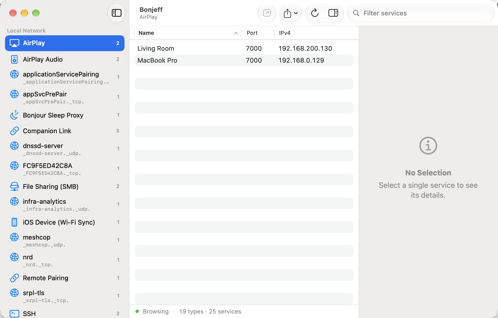

# Bonjeff

Bonjeff is a Mac app that shows you a live display of the Bonjour services published on your network. Bonjeff is intended as a replacement for the discontinued Bonjour Browser app by Tildesoft. Bonjour Browser predated Gatekeeper and thus is not code signed with a Developer ID certificate or notarized by Apple. Bonjeff is validly code signed and notarized, which allows it to be installed on Macs protected by Gatekeeper.



Requires macOS 14 Sonoma or later.

## Features

### Browse

- **Sidebar of service types**, grouped by domain, each with a human-readable name, an icon and a live count of devices advertising it. The protocol string (for example `_ipp._tcp.`) is shown under names that are not well known.
- **Table of instances** for the selected type. Columns: Name, Host, Port, IPv4, IPv6. Click a header to sort, right-click a header to show or hide columns. Host and IPv6 are hidden by default; the choice is remembered per window.
- **Inspector** with the service name, type, protocol and domain, then the resolved host, port and every address, then the full TXT record. Every value has a copy button; binary TXT values are shown as hex with a byte count.
- **Live updates.** Services appear and disappear as devices come and go. Discovery results are batched during the initial burst so the list settles quickly on a busy network.
- **Status bar** with the number of types and services found, and any browsing error.
- **Refresh** (⌘R) starts browsing again from scratch and keeps your selection.

### Identify

Bonjeff names service types from several sources, in this order:

1. **Your own names.** Right-click a type and choose **Rename…**. Your name is shown with the protocol underneath and persists across launches. **Use Default Name** reverts.
2. **A curated list** of about 90 common types with names, icons and URL schemes, from AirPlay and printers to Thread border routers and Apple's Continuity services.
3. **TXT-record hints** for apps that advertise an opaque type but a recognizable TXT record, such as QuickDrop.
4. **The IANA service-name registry.** A copy of the official registry ships inside the app and describes thousands of registered protocols. Once a week the app downloads a fresh copy of that one public file from iana.org. This can be turned off in Settings.
5. **Patterns.** A type named after a MAC address is labelled "Device-Specific".

Anything still unknown is shown by its raw protocol string. Right-click it for **Copy Protocol Name** or **Search the Web for "…"**, which opens your browser only when you ask.

### Decode

Many devices publish machine-generated instance names. The inspector explains the ones it recognizes, and the table shows the host under such names so each row stays identifiable:

| Name format | Example | Decoded as |
|---|---|---|
| Apple mobile device | `ec:81:50:b7:8b:e6@fe80::…-supportsRP-26` | MAC address, link-local IPv6, Remote Pairing capability, iOS version |
| AirPlay audio | `7AD359201C0B@Living Room` | MAC address, device name |
| Bonjour Sleep Proxy | `70-35-60-63.1 Living Room` | Proxy score (type, portability, power), metric, device name |
| Thread radio link | `ce4d5d96248bfd21` | Thread extended address |
| Generated identifiers | UUIDs and long base32 strings | Marked as device-generated |

### Act

- **Open** (⌘↩, the toolbar button, or double-click a row) opens the service in its default app when the type has a URL scheme: web servers, SSH, SFTP, VNC, RDP, SMB, AFP, NFS, FTP, IPP and RTSP.
- **Copy** (⌘C) copies the selected rows as tab-separated text. The Service menu adds **Copy Host** (⌥⌘C), **Copy Address** and **Copy as JSON** (⇧⌘C); the row's context menu has the same plus **Copy Name**.
- **Resolve Again** (⇧⌘R) re-resolves the selected services.
- **Export** all discovered services as **JSON** (⌘E) or **CSV** (⇧⌘E) from the toolbar or the File menu.
- **Search** (the toolbar field) filters the sidebar and the table together. It matches type names and protocols, instance names, hosts, ports, every address, every TXT key and value, and the decoded name fields, so "iOS 26" or a formatted MAC address finds the device.
- **Show or hide the inspector** with ⌥⌘I.

### Settings

Open with ⌘,.

| Setting | Default | Effect |
|---|---|---|
| Resolve services automatically | Off | Look up host, port and addresses for every service as soon as it appears. Off resolves only the selected type and uses less network traffic. |
| Show protocol names in the sidebar | Off | Always show the raw protocol string under the type name. |
| Include peer-to-peer (AWDL) services | On | Also discover services advertised over Apple's peer-to-peer Wi-Fi link. |
| Update service names from IANA weekly | On | Refresh the bundled IANA registry from iana.org. The panel also shows the last update time, the number of known names, and an **Update Now** button. |

## Privacy

Bonjeff is sandboxed and runs with the hardened runtime. It listens to Bonjour on your local network and resolves the services you look at. The only outbound request it ever makes is the optional weekly download of the IANA registry file, which carries no information about you or your network. There are no analytics, no accounts and no third-party code.

On macOS 15 and later the system asks for Local Network permission on first launch. If the sidebar stays empty, check System Settings › Privacy & Security › Local Network.

## Installing

1. Download the [latest release](https://github.com/lapcat/Bonjeff/releases/latest).
2. Unzip the downloaded `.zip` file.
3. Move `Bonjeff.app` to your Applications folder.

## Uninstalling

1. Move `Bonjeff.app` to the Trash.
2. Optionally remove its preferences and cached registry: `~/Library/Containers/com.lapcatsoftware.bonjeff`.

## Building

The Xcode project is generated from `project.yml` with [XcodeGen](https://github.com/yonaskolb/XcodeGen). The generated `Bonjeff.xcodeproj` is committed, so XcodeGen is only needed when you add or remove files:

```
brew install xcodegen
xcodegen generate
```

Run the tests with ⌘U in Xcode or:

```
xcodebuild test -scheme Bonjeff -destination 'platform=macOS'
```

Maintenance scripts:

- `swift scripts/generate-icon.swift nonsource/Assets.xcassets/AppIcon.appiconset` regenerates the app icon.
- `scripts/update-iana-registry.sh` refreshes the bundled IANA registry snapshot. Run it before tagging a release.

### Code signing

The project is configured to code sign the app. You need a valid Apple Development certificate in your keychain and your Apple Developer Program Team ID in the build settings. Create a file named `DEVELOPMENT_TEAM.xcconfig` in the project folder (next to [Base.xcconfig](Base.xcconfig)) containing:

```
DEVELOPMENT_TEAM = [Your TeamID]
```

The [.gitignore](.gitignore) file keeps `DEVELOPMENT_TEAM.xcconfig` out of the repository.

### Continuous integration

- `.github/workflows/ci.yml` builds and runs the tests on every push and pull request.
- `.github/workflows/release.yml` is started manually from the Actions tab with a tag name: it archives a Release build, signs it with a Developer ID certificate, notarizes and staples it, and publishes the zip as a GitHub release. It needs these repository secrets: `DEVELOPER_ID_CERTIFICATE_P12`, `DEVELOPER_ID_CERTIFICATE_PASSWORD`, `DEVELOPMENT_TEAM`, `NOTARY_APPLE_ID`, `NOTARY_PASSWORD`.

### Project layout

| Folder | Contents |
|---|---|
| `source/App` | App entry point and menu commands |
| `source/Model` | Service domain, type and instance models, naming catalog, IANA registry, TXT and name decoders |
| `source/Discovery` | The Bonjour browser and its `NetServiceBrowser` sessions |
| `source/Views` | SwiftUI sidebar, table, inspector, status bar, settings and license views |
| `source/Support` | Settings, export, pasteboard and small helpers |
| `Tests` | Swift Testing unit tests for parsing, naming, search and export |
| `nonsource` | Info.plist, entitlements, asset catalog, string catalog, bundled IANA registry |

## Credits

Bonjeff was created by [Jeff Johnson](https://lapcatsoftware.com/) of Lapcat Software. The original project lives at [github.com/lapcat/Bonjeff](https://github.com/lapcat/Bonjeff), and its discovery design is still the heart of this app: the meta-query that enumerates service types, lazy resolving, case-insensitive de-duplication, and the careful handling of malformed TXT records all come from that code.

This version started from the fork at [github.com/YesThatAllen/Bonjeff](https://github.com/YesThatAllen/Bonjeff), whose maintainer also contributed README updates to the original project. The hex display of binary TXT record data in Bonjeff 2.0.1 was contributed upstream by [bauerschwan](https://github.com/bauerschwan).

The SwiftUI interface, service-name identification, IANA registry integration, name decoding, export and search in version 3.0 were added on top of that work. Thanks to everyone who made the original available and kept it alive.

## Author

Original author: [Jeff Johnson](https://lapcatsoftware.com/)

To support the original author, you can [PayPal.Me](https://www.paypal.me/JeffJohnsonWI) or buy StopTheMadness Pro in the [Mac App Store](https://apps.apple.com/app/stopthemadness/id6471380298?mt=12).

## Copyright

Bonjeff is Copyright © 2017-2026 Jeff Johnson. All rights reserved.

## License

See the [LICENSE.txt](LICENSE.txt) file for details.
